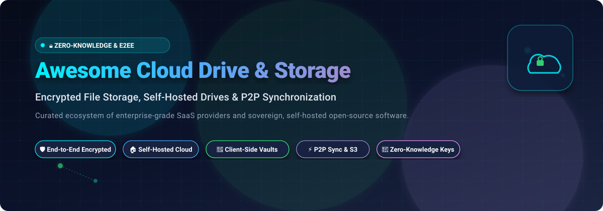

# 🛡️ Awesome-Cloud-Drive-Encrypted-File-Storage

  

  
  
  
  
  
  

---

## 🌟 Top Cloud Drive & Encrypted File Storage Ecosystem

> **Curated List of SaaS/Hosted Platforms & Open-Source GitHub Projects**  
> *Focused on Self-Hosted Cloud Drives, Zero-Knowledge End-to-End Encrypted Storage (E2EE), Client-Side File Encryption Vaults, and Peer-to-Peer (P2P) File Sync.*  
> **Last updated: November 2026**

This repository is an SEO-optimized, community-driven index tracking the most trusted **SaaS hosted platforms** and **open-source software** for **Cloud Drive & Encrypted File Storage**. Whether you need enterprise cloud collaboration with Client-Side Encryption (CSE), self-hosted private cloud drives for your homelab, transparent cryptographic vaults for third-party clouds, or serverless peer-to-peer file synchronization, this guide covers the ecosystem leaders.

---

## 📑 Table of Contents

- [📊 Sector Overview & Market Dynamics](#-sector-overview--market-dynamics)
- [☁️ SaaS & Hosted Platforms](#️-saas--hosted-platforms)
- [🔓 Open-Source GitHub Projects](#-open-source-github-projects)
- [🛠️ Recommended Architecture & Frameworks](#️-recommended-architecture--frameworks)
- [🤝 How to Contribute](#-how-to-contribute)
- [💖 Support & Share](#-support--share)
- [📈 Star History](#-star-history)
- [⚠️ Disclaimer](#️-disclaimer)

---

## 📊 Sector Overview & Market Dynamics

The global cloud storage and file synchronization market is valued at approximately **$150B–$190B** (projected to surpass $500B by the early 2030s at an ~18–23% CAGR driven by explosive unstructured data generation and enterprise AI pipelines). The sector is **moderately concentrated** at the top—where hyperscale tech giants (Google, Microsoft, AWS) capture over 60% of mainstream workspace storage—while maintaining a highly fragmented landscape of specialized challengers competing aggressively on zero-knowledge encryption, sovereignty compliance, and predictable egress-free pricing.

---

## ☁️ SaaS & Hosted Platforms

| Platform | 🏢 Company Size (Valuation / Revenue) | 💳 Pricing (Starting Tier) | 🎁 Free Tier Limits | 📝 Description |
| :--- | :--- | :--- | :--- | :--- |
| **[Microsoft OneDrive](https://microsoft.com)** | Valuation: ~$3.1T+ / Rev: ~$245B+ (Microsoft) | $1.99/mo ($19.99/yr) for Microsoft 365 Basic (100 GB) | 5 GB permanent free storage across OneDrive (with 15 GB Outlook mailbox) | Deeply integrated Windows and Microsoft 365 cloud file synchronization service featuring Personal Vault 2FA-protected storage and ransomware recovery. |
| **[Google Drive (Google One)](https://google.com)** | Valuation: ~$2.1T+ / Rev: ~$350B+ (Alphabet) | $1.99/mo ($19.99/yr) for Basic plan (100 GB) | 15 GB permanent free shared storage across Google Drive, Gmail, and Google Photos | Ubiquitous cloud file storage, real-time document collaboration, and AI-indexed workspace platform with optional Client-Side Encryption (CSE) for enterprise tiers. |
| **[Dropbox](https://dropbox.com)** | Valuation: ~$7.2B Market Cap / Rev: ~$2.52B | $9.99/mo (billed annually at $119.88/yr) or $11.99/mo for Plus (2 TB) | 2 GB permanent free storage with 3 connected device limit and 30-day version history | Cross-platform cloud file sync, block-level delta transfer, and team content collaboration platform with smart workspace organization. |
| **[Box](https://box.com)** | Valuation: ~$4.8B Market Cap / Rev: ~$1.09B | $10.00/mo (billed annually) or $14.00/mo for Personal Pro (100 GB) | 10 GB permanent free storage (with 250 MB single-file upload limit) | Enterprise cloud content management and workflow platform offering granular governance, e-signatures, and customer-managed encryption keys (Box KeySafe). |
| **[Proton Drive](https://proton.me)** | Valuation: Non-profit Proton Foundation (Unsold / Rev: ~$97M ARR) | $3.99/mo (billed annually at $47.88/yr) or $4.99/mo for Drive Plus (200 GB) | 5 GB permanent free storage (starts at 2 GB, unlock up to 5 GB via onboarding checklist) | Swiss-based, open-source-client end-to-end encrypted cloud storage and collaborative document platform backed by strict Swiss privacy laws and zero-access cryptography. |
| **[MEGA](https://mega.io)** | Valuation: Private / Rev: ~$15M–$60M estimated | €3.33/mo (~$3.66/mo billed annually) for Essential plan (200 GB) | 20 GB permanent free zero-knowledge encrypted base storage (expandable via bonus tasks) | User-controlled end-to-end encrypted cloud drive, backup, and secure chat/file-transfer platform with zero-knowledge cryptographic key management. |
| **[Tresorit](https://tresorit.com)** | Valuation: Acquired by Swiss Post (~$51M prev. val / Rev: ~€8.2M ARR) | $11.99/mo (billed annually at $143.88/yr) for Personal Essential (1 TB) | 3 GB permanent free storage on Tresorit Basic (max 500 MB file size, 2 connected devices); or 14-day free trial on paid plans | Enterprise-grade zero-knowledge end-to-end encrypted cloud storage and secure file-sharing suite engineered for regulated industries and confidential team collaboration. |
| **[Sync.com](https://sync.com)** | Valuation: Private Bootstrapped / Rev: ~$5M–$10M ARR | $8.00/mo (billed annually at $96.00/yr) for Solo Basic (2 TB) | 5 GB permanent free end-to-end encrypted storage (3 active shared links and folders) | Privacy-focused cloud storage and document collaboration platform providing default client-side end-to-end encryption, granular link permissions, and compliance auditing. |
| **[pCloud](https://pcloud.com)** | Valuation: Private ($3M raised / Rev: ~$4M–$10M ARR) | $4.99/mo (or $49.99/yr) for Premium (500 GB); $199 one-time Lifetime | 10 GB permanent free storage (starts at 2 GB, unlock up to 10 GB via verification tasks) | Cloud storage platform offering virtual drive mounting (`pCloud Drive`), lifetime storage plans, and optional client-side zero-knowledge encryption (`pCloud Crypto`). |
| **[Icedrive](https://icedrive.net)** | Valuation: Private Bootstrapped (ID Cloud Services Ltd / Rev: Undisclosed) | $2.99/mo (or $19.99/yr) for Lite (100 GB) | 10 GB permanent free cloud storage (no credit card required) | Modern cloud storage service featuring Twofish client-side encryption, virtual drive integration, and a fast web/mobile file browser. |

---

## 🔓 Open-Source GitHub Projects

All open-source repositories below are sorted in **descending order by GitHub star count**. Each project badge dynamically links directly to that repository's stargazers page:

1. **[Syncthing (`syncthing/syncthing`)](https://github.com/syncthing/syncthing)**   
   ⚡ Continuous, decentralized open-source peer-to-peer file synchronization utility written in Go that syncs folders directly across devices with TLS encryption and zero central relay dependencies.

2. **[MinIO (`minio/minio`)](https://github.com/minio/minio)**   
   🪣 High-performance, S3-compatible enterprise object storage suite supporting server-side encryption (SSE-KMS / SSE-C), multi-cloud replication, and Kubernetes-native deployment.

3. **[rclone (`rclone/rclone`)](https://github.com/rclone/rclone)**   
   🧰 The Swiss Army knife for cloud storage ("rsync for cloud storage"). Supports 70+ cloud storage backends, transparent on-the-fly client-side encryption (`rclone crypt`), and virtual FUSE drive mounting.

4. **[Nextcloud Server (`nextcloud/server`)](https://github.com/nextcloud/server)**   
   🏰 Flagship self-hosted open-source content collaboration and private cloud drive platform offering desktop/mobile sync clients, end-to-end folder encryption, and hundreds of modular apps.

5. **[Restic (`restic/restic`)](https://github.com/restic/restic)**   
   🔒 Fast, secure, and deduplicated cryptographic backup program written in Go that encrypts files with AES-256 and snapshots them to any cloud or local destination.

6. **[FileBrowser (`filebrowser/filebrowser`)](https://github.com/filebrowser/filebrowser)**   
   📂 Ultra-lightweight, single-binary web file manager written in Go providing an intuitive Google Drive-style browser interface over any server directory.

7. **[Ente (`ente-io/ente`)](https://github.com/ente-io/ente)**   
   📸 Fully open-source, end-to-end encrypted cloud alternative to Google Photos and Apple Photos with cross-platform desktop and mobile sync clients.

8. **[Cryptomator (`cryptomator/cryptomator`)](https://github.com/cryptomator/cryptomator)**   
   🛡️ Leading open-source, multi-platform client-side encryption vault utility that creates transparent virtual encrypted drives inside Google Drive, Dropbox, OneDrive, or local disks.

9. **[Seafile (`haiwen/seafile`)](https://github.com/haiwen/seafile)**   
   🌊 High-performance open-source enterprise file sync and share system written in C/Python featuring Git-like block-level delta syncing, virtual drive mounting, and client-side encrypted libraries.

10. **[Duplicati (`duplicati/duplicati`)](https://github.com/duplicati/duplicati)**   
    💾 Free, open-source backup client that securely stores encrypted, incremental, compressed backups on local storage and cloud drive providers.

11. **[Filestash (`mickael-kerjean/filestash`)](https://github.com/mickael-kerjean/filestash)**   
    🌐 Modern web client for your data that turns any SFTP, S3, WebDAV, Git, or cloud storage server into an online cloud drive like Google Drive.

12. **[Kopia (`kopia/kopia`)](https://github.com/kopia/kopia)**   
    🚀 Fast and secure open-source backup tool featuring end-to-end zero-knowledge encryption, deduplication, and direct integration with cloud drive storage.

13. **[BorgBackup (`borgbackup/borg`)](https://github.com/borgbackup/borg)**   
    🛡️ Deduplicating archiver with authenticated encryption (AES-256 or ChaCha20-Poly1305), ideal for daily encrypted offsite backups to cloud targets.

14. **[SFTPGo (`drakkan/sftpgo`)](https://github.com/drakkan/sftpgo)**   
    📡 Full-featured event-driven file transfer and cloud storage server supporting SFTP, HTTP/S WebClient, WebDAV, and S3/Azure/GCS backends with encryption at rest.

15. **[OpenCloud (`opencloud-eu/opencloud`)](https://github.com/opencloud-eu/opencloud)**   
    🇪🇺 Community-driven cloud collaboration platform forked from oCIS, focused on digital sovereignty, fast Go microservices, and European privacy standards.

16. **[Garage (`deuxfleurs-org/garage`)](https://github.com/deuxfleurs-org/garage)**   
    🚗 Lightweight, distributed S3-compatible object store written in Rust, engineered to run across self-hosted multi-datacenter and homelab clusters.

17. **[gocryptfs (`rfjakob/gocryptfs`)](https://github.com/rfjakob/gocryptfs)**   
    🔐 Fast, encrypted overlay filesystem written in Go using GCM file content encryption and EME filename encryption, built specifically for syncing encrypted folders to the cloud.

18. **[zenhosta/9drive](https://github.com/zenhosta/9drive)**   
    📁 Open-source lightweight cloud drive and file storage project designed for clean self-hosted file management, sharing, and personal cloud deployment.

19. **[Peergos (`Peergos/Peergos`)](https://github.com/Peergos/Peergos)**   
    🪐 Peer-to-peer, post-quantum end-to-end encrypted storage and secure social file-sharing protocol built on IPFS with metadata privacy.

20. **[CryFS (`cryfs/cryfs`)](https://github.com/cryfs/cryfs)**   
    🔒 Cryptographic filesystem engineered specifically for cloud storage that hides metadata, file sizes, and directory structures by splitting files into equal-sized blocks.

21. **[Pydio Cells (`pydio/cells`)](https://github.com/pydio/cells)**   
    🏢 Enterprise-grade open-source document sharing, sync, and collaboration platform built on a Go microservice architecture.

22. **[ownCloud Infinite Scale — oCIS (`owncloud/ocis`)](https://github.com/owncloud/ocis)**   
    ⚡ Modern, cloud-native file sync and share platform rewritten in Go as a single binary with zero database dependencies and high-throughput storage backends.

23. **[Copyparty (`9001/copyparty`)](https://github.com/9001/copyparty)**   
    🎉 Portable single-file Python file server turning almost any machine into a resumable-upload WebDAV/HTTP cloud drive and media streamer.

---

## 🛠️ Recommended Architecture & Frameworks

Looking to build a sovereign, zero-knowledge private cloud setup? Recommended combinations:
- **Collaborative Self-Hosted Cloud**: Run **[Nextcloud](https://github.com/nextcloud/server)** or **[ownCloud Infinite Scale](https://github.com/owncloud/ocis)** as your web & mobile team hub.
- **Client-Side Zero-Knowledge Encryption**: Layer **[Cryptomator](https://github.com/cryptomator/cryptomator)** or **[rclone crypt](https://github.com/rclone/rclone)** over commercial clouds (Google Drive, OneDrive, Dropbox) or S3 buckets to guarantee zero access by third parties.
- **Serverless Decentralized Synchronization**: Deploy **[Syncthing](https://github.com/syncthing/syncthing)** to synchronize project folders directly peer-to-peer across workstations and laptops without any central server.
- **High-Performance Object Storage**: Power your backend storage using **[MinIO](https://github.com/minio/minio)** or **[Garage](https://github.com/deuxfleurs-org/garage)**.

---

## 🤝 How to Contribute

Contributions are welcome and appreciated! To propose changes:
1. 🍴 Fork the repository.
2. 🌿 Create a feature branch (`git checkout -b feature/new-storage-tool`).
3. 📝 Add or edit entries in `README.md` (keep descriptions concise, objective, and link to official sources).
4. 🚀 Submit a pull request with a brief explanation of the entry.

Please star ⭐ the repository if you find this ecosystem guide valuable!

---

## 💖 Support & Share

Thank you for exploring this curated repository! If this resource saved you time or helped you build a more secure, private cloud storage setup, your support helps maintain and expand the project:

- ⭐ **Star this repository** to improve visibility and help other privacy-minded developers and sysadmins find it.
- 🍴 **Fork & Share** it with your engineering team, homelab community, or on social media (X/Twitter, LinkedIn, Reddit).
- ☕ **Buy me a coffee / Sponsor**: If you'd like to sponsor continued updates, please consider supporting via the [GitHub Sponsors Dashboard](https://github.com/sponsors/ishandutta2007) — featuring tiers for sponsor badges, README shoutouts, and prioritized feature requests!

  

---

## 📈 Star History

---

## ⚠️ Disclaimer

- This is a **community-curated** list — not an exhaustive catalog or commercial endorsement.
- **Cryptographic Caution**: When using zero-knowledge client-side encryption tools (such as `Cryptomator`, `rclone crypt`, `Proton Drive`, or `Tresorit`), losing your master passphrases or recovery keys permanently renders your data unrecoverable. Always store recovery keys securely offline.
- **Self-Hosting Security**: Any self-hosted cloud storage instance exposed to the public internet must enforce HTTPS/TLS, robust multi-factor authentication (MFA), regular security updates, and offsite automated database backups.

---

  <b>Made with ❤️ for privacy advocates, homelab builders, sysadmins, and open-source contributors.</b> 
  Let's build a more open, private, and sovereign cloud together.

